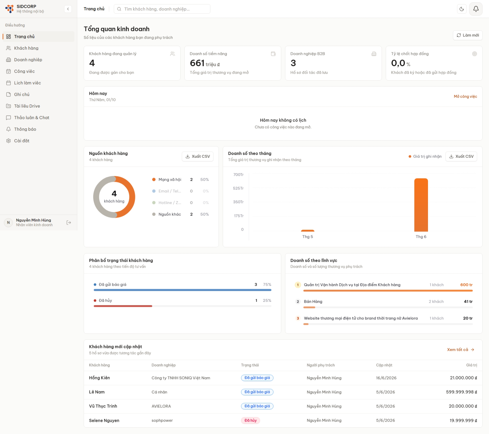

# CRM-SIDCORP – Hệ Thống Quản Lý Khách Hàng & Làm Việc Nội Bộ

Ứng dụng CRM cho đội kinh doanh: quản lý khách hàng và doanh nghiệp, theo dõi thương vụ, lên lịch công việc, lưu trữ tài liệu và trò chuyện nội bộ theo thời gian thực, tất cả trong một giao diện.

🔗 **Demo:** https://bd-sidcorp.vercel.app/



## 🌟 Tính Năng

### Quản lý khách hàng & kinh doanh
- Dashboard tổng quan: khách hàng đang quản lý, doanh số tiềm năng, tỷ lệ chốt hợp đồng, doanh số theo tháng và theo lĩnh vực, xuất CSV.
- Quản lý khách hàng cá nhân và doanh nghiệp B2B, trạng thái tư vấn (đã gửi báo giá, đã hủy…), nguồn khách, giá trị thương vụ.
- Timeline tương tác và ghi chú theo từng khách hàng; gõ `@Tên_nhân_viên` để tag đồng nghiệp và gửi thông báo realtime.

### Làm việc nhóm
- **Công việc & Lịch làm việc**: tạo, giao việc, xem theo lịch, nhắc lịch họp tự động.
- **Ghi chú** và **Tài liệu Drive**: lưu trữ, chia sẻ file đính kèm.
- **Thảo luận & Chat**: nhắn tin 1-1 và kênh nhóm, trạng thái online/offline theo thời gian thực.
- **Thông báo** realtime khi có tin nhắn, được nhắc tên hoặc được giao việc.

### Bảo mật & phân quyền
- Xác thực JWT, mã hóa mật khẩu bằng bcrypt.
- Phân quyền `admin` / `user`; admin duyệt tài khoản mới và quản lý dữ liệu của cả đội.
- Helmet, rate limiting, CORS whitelist.

### Giao diện
- Thiết kế lại toàn bộ UI/UX theo phong cách tối giản, nhất quán giữa các trang.
- Hỗ trợ chế độ sáng / tối, responsive.
- Tối ưu hiệu năng: giảm render-blocking, preload ảnh LCP, chia nhỏ bundle.

## 🛠 Công Nghệ

| Phần | Công nghệ |
|---|---|
| Frontend | React 19, TypeScript, Vite, Tailwind CSS, React Query, Zustand, React Router, Socket.io-client |
| Backend | Node.js, Express, TypeScript, Socket.io, Zod, JWT, Multer |
| Database | PostgreSQL (Supabase + Prisma), MongoDB Atlas (Mongoose) |
| Lưu trữ & hạ tầng | Supabase Storage, Redis (tùy chọn, để scale nhiều instance), Vercel |

Dự án dùng kiến trúc **Polyglot Persistence**:
- **PostgreSQL (Supabase + Prisma)**: dữ liệu có cấu trúc – người dùng, khách hàng, doanh nghiệp, công việc, phân quyền.
- **MongoDB Atlas (Mongoose)**: dữ liệu linh hoạt, tăng nhanh – lịch sử chat, ghi chú, thông báo.
- **Supabase Storage**: file đính kèm và tài liệu.

## 👥 Thành Viên & Vai Trò

Dự án nhóm. Các thành viên: [@MiinhHung](https://github.com/MiinhHung), [@Lebao1234](https://github.com/Lebao1234), [@MatthewLK13](https://github.com/MatthewLK13).

**Nguyễn Minh Hùng ([@MiinhHung](https://github.com/MiinhHung))**
- Thiết kế và xây dựng giao diện UI/UX cho toàn bộ hệ thống (dashboard, khách hàng, công việc, lịch, chat, cài đặt…).
- Thiết lập và kết nối cơ sở dữ liệu: PostgreSQL trên Supabase qua Prisma, MongoDB Atlas qua Mongoose, Supabase Storage.
- Áp dụng quy trình phát triển có AI hỗ trợ: Claude Code kết hợp skill tùy chỉnh (`SKILL.md`) và MCP Playwright để tự động kiểm thử, rà soát giao diện trên trình duyệt thật.

## 🚀 Cài Đặt

### Yêu cầu
- Node.js `v22.15.0` (khuyên dùng [nvm](https://github.com/nvm-sh/nvm)).
- Tài khoản Supabase và MongoDB Atlas (miễn phí) – xem [DATABASE_SETUP.md](./DATABASE_SETUP.md).

### Biến môi trường
Sao chép file mẫu rồi điền giá trị thật:
```bash
cp backend/.env.example backend/.env
cp frontend/.env.example frontend/.env
```

### Chạy ở chế độ Development

**Backend**
```bash
cd backend
npm install
npm run prisma:generate  # Khởi tạo Prisma Client
npm run prisma:migrate   # Đồng bộ bảng dữ liệu vào PostgreSQL
npm run dev              # http://localhost:5000
```

**Frontend** (terminal khác)
```bash
cd frontend
npm install
npm run dev              # http://localhost:5173
```

### Build Production
```bash
# Backend
cd backend && npm install && npm run prisma:generate && npm run build
npm start

# Frontend
cd ../frontend && npm install && npm run build
```
